<p align="center">
  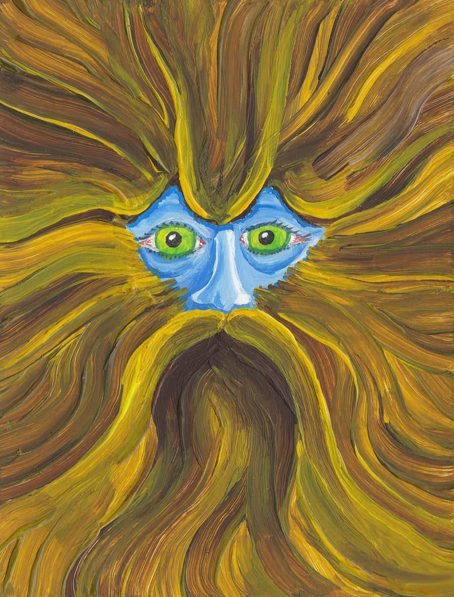
</p>

<h1 align="center">Kokino Forensic Toolkit</h1>

<h3 align="center">Every finding, traceable to the byte.</h3>

<p align="center">
  Open-source disk forensics by <a href="https://www.zeroscience.mk">Zero Science Lab</a>.<br>
  One portable Rust binary with a browser GUI, on Windows, Linux and macOS.
</p>

<p align="center">
  <a href="https://github.com/zeroscience/Kokino/actions/workflows/ci.yml"></a>
  <a href="https://github.com/zeroscience/Kokino/releases"></a>
  <a href="https://github.com/zeroscience/Kokino/releases"></a>
  <a href="LICENSE"></a>
</p>

<p align="center">
  
  
  
  
  
  
  <a href="SECURITY.md#fuzzing-the-parsers"></a>
  
  <a href="VALIDATION.md"></a>
  
  
</p>

<p align="center">
  <a href="https://github.com/zeroscience/Kokino/stargazers"></a>
  <a href="https://github.com/zeroscience/Kokino/network/members"></a>
  <a href="https://github.com/zeroscience/Kokino/watchers"></a>
</p>

<p align="center">
  <a href="https://github.com/zeroscience/Kokino/issues"></a>
  <a href="https://github.com/zeroscience/Kokino/pulls"></a>
  <a href="https://github.com/zeroscience/Kokino/commits/main"></a>
  <a href="https://github.com/zeroscience/Kokino/graphs/commit-activity"></a>
  <a href="https://github.com/zeroscience/Kokino/graphs/contributors"></a>
  
  
  
  
</p>

<p align="center">
  <a href="#features">Features</a> |
  <a href="#screenshots">Screenshots</a> |
  <a href="#install">Install</a> |
  <a href="#quick-start-from-source">Build</a> |
  <a href="#forensic-soundness">Forensic soundness</a> |
  <a href="SECURITY.md">Security</a> |
  <a href="VALIDATION.md">Validation</a> |
  <a href="docs/ARCHITECTURE.md">Architecture</a> |
  <a href="ROADMAP.md">Roadmap</a> |
  <a href="CHANGELOG.md">Changelog</a> |
  <a href="#contact">Contact</a>
</p>

---

Kokino Forensic Toolkit (Kokino FTK) is an open-source digital forensics workbench for disk images. Give it an E01, raw, VHD, VHDX or VMDK image, or a disc image, and it reads every NTFS, FAT, exFAT, ext2/3/4, HFS+, APFS, ISO 9660 and UDF volume down to the last record, live and deleted, brings back what was erased, and rebuilds what happened on the machine: Windows registry, event logs and execution traces, Linux logons, shell histories and persistence, browser history, carved files and edited pictures.

Every finding links to the exact bytes it came from, every indicator of anti-forensic activity explains itself, and every examiner action lands in a hash-chained audit log, so the results hold up in a report and in court.

> Status: 1.2.8 goes deeper into Windows: the NTFS change journal, names of deleted files from folder index slack and $LogFile, ShellBags, BAM/DAM and SRUM (with Kokino's own ESE database reader, checked against Windows' own on a real database). Reads E01, raw and virtual disks, and NTFS, FAT, exFAT, ext2/3/4, HFS+, APFS, ISO 9660 and UDF. Validated against NIST CFReDS and Digital Corpora test images ([VALIDATION.md](VALIDATION.md)); parsers fuzzed ([SECURITY.md](SECURITY.md)). Next: Ex01, macOS artifacts and APFS snapshots (see [What's next](#whats-next)).

## Features

- **Cases and integrity:** case store, evidence registration, single-pass MD5 / SHA-1 / SHA-256, verification against the acquisition hash, and a hash-chained audit log of every examiner action (`kokino verify-audit`).
- **Images:** E01 (EWF, all segments, compressed or not), raw / dd, split raw (`.001`, `.002`, ...), and virtual disks: VHD (fixed, dynamic, differencing), VHDX (dynamic, fixed, differencing) and VMDK (flat, sparse, streamOptimized, split, snapshots), with parent disks found and checked automatically. For E01, Kokino checks the media against the hash the imaging tool stored in the image, shows the acquisition details it recorded (case, examiner, dates, device, tool) and flags sectors the imager could not read. Ex01 is detected and reported.
- **Volumes:** MBR (including extended partitions), GPT, unallocated gaps. Parses NTFS, FAT12/16/32, exFAT, ext2/3/4, ISO 9660, UDF, HFS+ and APFS; detects and reports BitLocker.
- **NTFS:** every MFT record including deleted ones, $SI and $FN times at full 100 ns precision, alternate data streams, orphans, resident data, data-run offsets. Records that cannot be parsed are reported, never dropped silently. Names of deleted files whose MFT record was reused are recovered from folder index slack ($I30) and the NTFS log ($LogFile), with their times and size, and old names of renamed files with them. The change journal ($UsnJrnl) tells what happened to each file and when: created, written, renamed, deleted.
- **FAT12/16/32 and exFAT:** USB sticks, SD and camera cards. Live files follow the FAT chain; deleted files and folders are listed with their long names restored, their content read from the first cluster on, and a note when the clusters were reused or the first cluster no longer holds the file's header.
- **ext2/3/4:** Linux servers and desktops. Every inode, extents and block maps, directories with the names of deleted files recovered from directory slack, orphaned inodes, owner, mode, inode change and deletion times (ext4 to the nanosecond, with creation time). ext3 and ext4 clear a deleted file's block map; Kokino reads it back from an older copy of the inode kept in the journal when there is one, and says when there is not (then only carving can help).
- **Optical discs and .iso files:** ISO 9660 with Rock Ridge (POSIX names, owners, modes, times, symbolic links, deep folders) and Joliet (Unicode names), multisession discs (the newest session is the live tree; files only older sessions list are shown as deleted, and their content is read from the disc), and UDF 1.02 to 2.60 (DVD, Blu-ray, packet writing) with directory entries marked deleted listed with what their file entry still holds.
- **Mac disks (HFS+ and APFS):** HFS+ and HFSX with hard links resolved, resource forks, extended attributes (including the quarantine flag set on downloads) and HFS compression decoded (zlib and LZVN; 7-Zip shows such files as empty). APFS containers with every unencrypted volume, object maps, hard links, symbolic links, extended attributes and compression. Deleted files are recovered from old catalog-node copies in the HFS+ journal, and from the older file-system tree nodes that APFS leaves behind when it writes changes to new blocks. Encrypted (FileVault) APFS volumes are reported.
- **Linux system summary:** accounts (passwd, shadow, group, lastlog; second root accounts, passwordless and system accounts with a shell flagged), logons, failures and reboots (wtmp, btmp, auth.log or secure, journald), shell histories (bash, zsh, fish and more, with times when recorded) with destructive commands flagged, sudo and account changes, installed packages and who installed them (dpkg, apt history, dnf/yum, apk, pacman), persistence (cron, systemd units, rc.local, SSH authorized keys, sudoers, ld.so.preload), USB storage seen by the kernel, Wi-Fi and other networks, DHCP leases and SSH known hosts. Classic syslog times are converted with the image's own time zone.
- **Content:** about 70 file signatures, extension mismatch, Shannon entropy, uniform-content (wipe) detection.
- **Web activity:** browser history from Chrome, Edge, Brave, Opera, Vivaldi and Firefox profiles: page visits (with how the page was reached and whether the address was typed), pages only the URL table still remembers, downloads with source URL, saved path and state, and search terms. Databases are read with their -wal file, so recent activity the browser had not yet merged is included. Deleted or cleared histories are flagged.
- **Full-text search:** an index over every file stream (live and deleted), every free cluster and the space outside partitions, with UTF-8 and UTF-16 text, plus the text inside documents: Word, Excel, PowerPoint, OpenDocument, ZIP archives (nested too), GZIP and PDF (page text with ToUnicode fonts, document info and XMP). Keyword, regex and preset searches (emails, URLs, IPs, Luhn-checked card numbers, IBANs, Bitcoin addresses); each hit links to the file and to its exact byte in the hex view. Searches are audit-logged.
- **Windows system summary:** registry (SYSTEM, SOFTWARE, SAM, NTUSER.DAT, UsrClass.dat, Amcache), event logs, Prefetch (including Windows 10/11 compressed files), LNK shortcuts, Jump Lists, scheduled tasks, the NTFS change journal and SRUM, deleted copies included: computer and accounts, USB devices with serials and connect times, networks, installed programs and autostart entries, scheduled tasks with when they were created and last ran (hidden ones flagged), programs run (Prefetch, UserAssist, BAM/DAM, Amcache, ShimCache, 4688), how much each program sent over which network and read and wrote to disk, hour by hour (SRUM, read with Kokino's own ESE database reader), files and folders opened, every folder a user browsed to in Explorer (ShellBags, including USB sticks, network shares and ZIP files long gone), every file created, renamed or deleted per the change journal, and notable events in plain language (log clearing, logons, account and service creation, remote desktop, PowerShell).
- **File carving:** recovers files from free clusters, unpartitioned space and unparsed volumes by content, with format-aware end detection (JPEG, PNG, GIF, BMP, WebP, PDF, Office old and new, OpenDocument, ZIP, SQLite, executables, GZIP, 7-Zip, WAV, AVI, MP4, Jump Lists, event log chunks). Picture gallery, hashes, audited export, and carved documents in the search index.
- **Pictures (photo forensics):** every JPEG, PNG and BMP (live, deleted, carved) checked for editing software, an EXIF thumbnail that no longer matches, double JPEG compression, camera EXIF with software compression tables, tables that differ from the same camera's other photos, data appended after the image, and LSB embedding in lossless pictures; each finding states what it does not prove, and the detectors are calibrated on real camera photos. A viewer with magnifier, error level, noise, level sweep, gradient, bit planes and copy-move (clone) detection, region bookmarks, and `kokino image <file>` on the command line.
- **Bookmarks and tags:** bookmark files (hashed at bookmark time), events, carved files, search hits, browser history and byte ranges; tag and annotate them, filter by tag, and build a case report from them. Reviewers can tag too. All changes are audit-logged.
- **Hash sets and hash analysis:** import NIST NSRL (RDS v3 SQLite or SQL releases, or 2.x NSRLFile.txt), CSV or plain hash lists as known good or known bad; MD5, SHA-1 and SHA-256 of every file, matched against the enabled sets. Hide known-good files and flag known-bad ones in the explorer, file details and reports.
- **Byte map and strings:** a binvis-style picture of a file, carved file or the whole image along a Hilbert curve, colored by byte class or entropy, where a click opens that offset in hex; and printable strings (ASCII, UTF-8, UTF-16LE) with offsets and filters.
- **Case reports:** a court-ready report of the bookmarked exhibits as HTML (print to PDF) and Word (.docx): every exhibit read from the evidence again and its hashes re-checked, pictures with marked regions, hex dumps, chain of custody from the audit log, methods, limitations and a sign-off block. Each report file's SHA-256 is recorded in the audit log.
- **Timeline:** MACB events from $SI and $FN (inodes on ext, with deletion times) interleaved with browser visits, downloads, searches, Windows or Linux system events and files created, renamed and deleted per the NTFS change journal, filterable by path, date, source, deleted and flagged.
- **Anti-forensics likelihood:** 25 transparent indicators (timestomping, SDelete patterns in the MFT and in the change journal, wiped content, disguised executables, ADS payloads, encrypted containers, a missing or recreated $UsnJrnl, event logs cleared (including Windows' own 1102/104 records), cleared browser history, wiping tools downloaded, researched or run, Linux shell histories cleared, logs emptied, shred and history -c typed, ld.so.preload rootkits, scheduled tasks hidden from the Task Scheduler, ...) combined with noisy-OR. See [docs/ANTI-FORENSICS.md](docs/ANTI-FORENSICS.md).
- **Hex:** a virtualized viewer for images of any size, a data inspector (ints, FILETIME, Unix time, UTF-16), text and hex search, and **overlay editing**: edits are stored in the case and audit-logged, and the evidence file is never written. You can export a byte range raw or with the overlay applied.
- **Export and report:** file and stream export (hashed and audited) and a self-contained HTML report.
- **Updates:** Kokino never contacts anything on its own. "Check for updates" on the About page (or `kokino version --check`) asks GitHub for the latest release when you click it, shows its notes and checksums and links to the download; the check is recorded in the system audit log.
- **Built-in help:** a searchable Wiki (getting started, roles, evidence, every view, browser history, hex, reports, LAN mode, command line, troubleshooting) and an About page with version and contact.
- **Cases and accounts:** cases can be renamed, handed to another lead examiner, deleted and restored, all audit-logged. Every examiner signs in. Admins manage accounts and assign people to cases as examiner or reviewer (read-only). Every case action is attributed to the account in the audit log, and sign-ins are recorded in a hash-chained system audit log. Optional LAN mode serves HTTPS to a whole lab.

## What's next

- **Ex01:** EWF version 2 (EnCase 7 and later)
- **Later:** macOS artifacts (property lists, unified logs, KnowledgeC), APFS snapshots and encrypted volumes, BitLocker with a recovery key, Volume Shadow Copies, email stores, triage collection import

The full list, with what is already done, is in [ROADMAP.md](ROADMAP.md).
Suggestions are welcome as GitHub issues.

## Screenshots

<!-- Placeholders: replace each file in docs/screenshots/ with a real
     screenshot of the same name (16:10, for example 1600x1000, works best). -->

<table>
  <tr>
    <td width="50%" align="center"><a href="docs/screenshots/01-cases.png">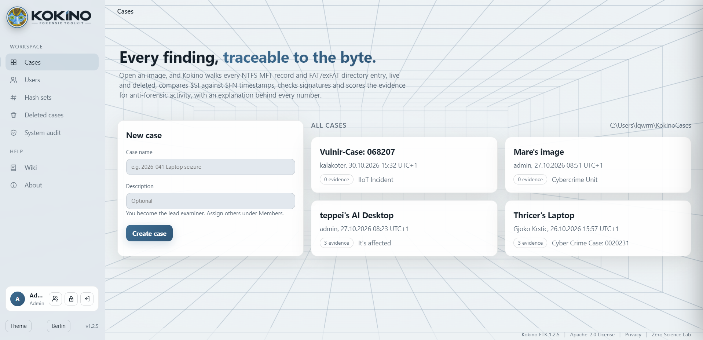</a><br><sub><b>Cases</b></sub></td>
    <td width="50%" align="center"><a href="docs/screenshots/02-evidence-summary.png">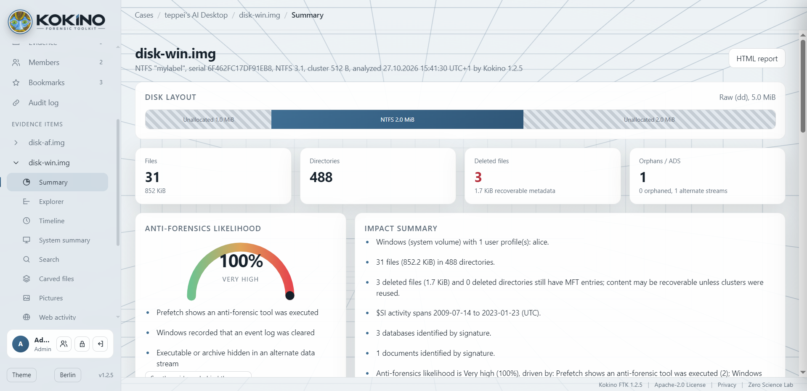</a><br><sub><b>Evidence summary and anti-forensics score</b></sub></td>
  </tr>
  <tr>
    <td width="50%" align="center"><a href="docs/screenshots/03-explorer.png">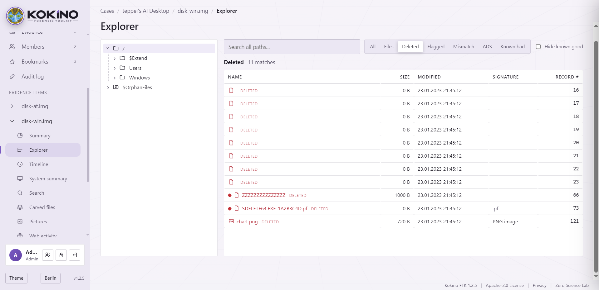</a><br><sub><b>File explorer (live and deleted)</b></sub></td>
    <td width="50%" align="center"><a href="docs/screenshots/04-timeline.png">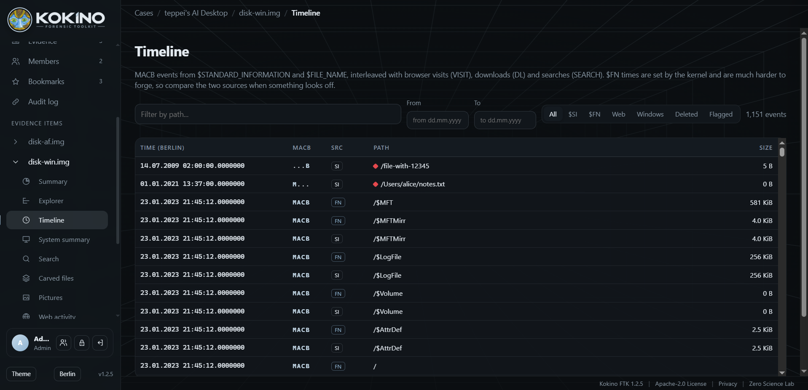</a><br><sub><b>Timeline</b></sub></td>
  </tr>
  <tr>
    <td width="50%" align="center"><a href="docs/screenshots/05-system-summary.png">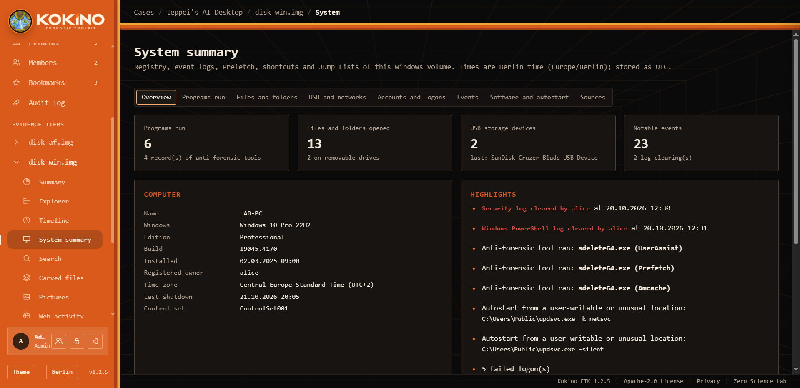</a><br><sub><b>Windows system summary</b></sub></td>
    <td width="50%" align="center"><a href="docs/screenshots/06-web-activity.png">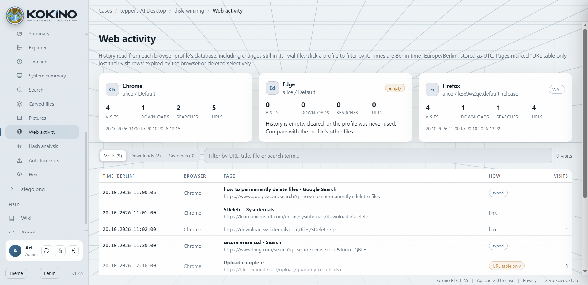</a><br><sub><b>Browser history</b></sub></td>
  </tr>
  <tr>
    <td width="50%" align="center"><a href="docs/screenshots/07-search.png">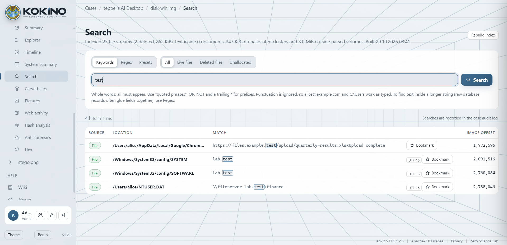</a><br><sub><b>Full-text search</b></sub></td>
    <td width="50%" align="center"><a href="docs/screenshots/08-carving.png">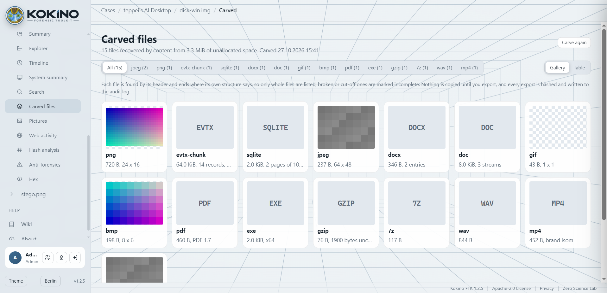</a><br><sub><b>Carved files</b></sub></td>
  </tr>
  <tr>
    <td width="50%" align="center"><a href="docs/screenshots/09-pictures.png">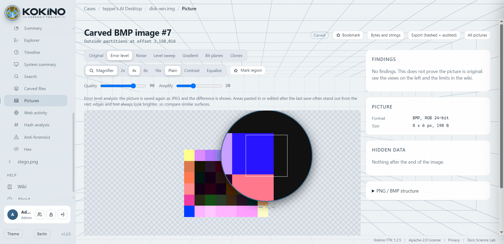</a><br><sub><b>Picture forensics</b></sub></td>
    <td width="50%" align="center"><a href="docs/screenshots/10-hex-bytemap.png">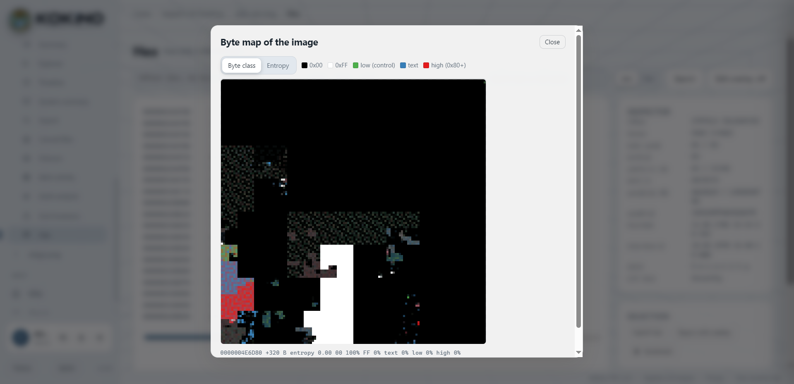</a><br><sub><b>Hex viewer and byte map</b></sub></td>
  </tr>
  <tr>
    <td width="50%" align="center"><a href="docs/screenshots/11-hash-sets.png">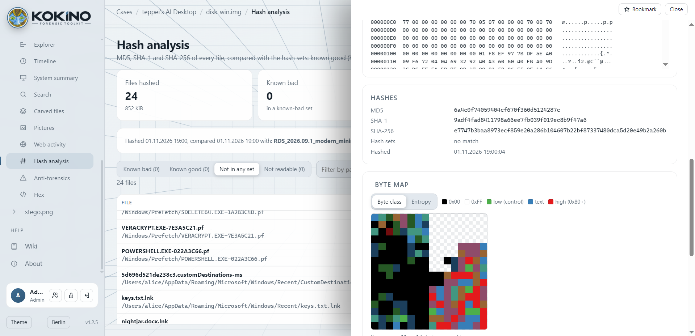</a><br><sub><b>Hash sets and hash analysis</b></sub></td>
    <td width="50%" align="center"><a href="docs/screenshots/12-case-report.png">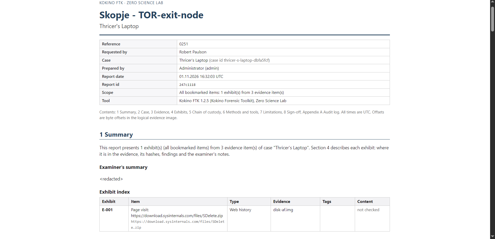</a><br><sub><b>Case report</b></sub></td>
  </tr>
</table>

## Install

Download the package for your system from
[Releases](https://github.com/zeroscience/Kokino/releases) and check it
against `SHA256SUMS.txt` there.

| System | Package | Start |
|---|---|---|
| Windows 10/11 (x64) | `kokino-<version>-windows-x64.msi` (or `.zip`) | Start menu: Kokino Forensic Toolkit |
| Linux (x86_64) | `kokino_<version>_amd64.deb` (Debian, Ubuntu, Kali) or `.tar.gz` | `kokino serve` |
| macOS 12+ (Intel and Apple Silicon) | `kokino-<version>-macos-universal.dmg` | Double-click "Start Kokino" |

Kokino starts a local server and opens your browser. The packages are not
code-signed yet: on Windows choose "More info", then "Run anyway"; on macOS
right-click "Start Kokino", choose Open, then Open again (the DMG's
"READ ME FIRST" explains). `kokino purge` removes everything Kokino stored on
the machine; uninstalling leaves your cases in place.

## Quick start (from source)

```bash
cargo build --release
./target/release/kokino serve
```

`serve` binds to 127.0.0.1 and opens your browser. On first start it prints a
one-time setup link that creates the first admin account. Cases go to
`~/KokinoCases` (override with `--cases`).

For a lab server that examiners reach from their own machines:

```bash
./target/release/kokino serve --listen 0.0.0.0 --port 8443 --hostname forensics.lab
```

LAN mode always uses HTTPS. Pass `--tls-cert` and `--tls-key` for your own
certificate, or Kokino creates a self-signed one and prints its fingerprint.

Accounts can also be managed from the server console, which is the way back in
if every admin is locked out:

```bash
./target/release/kokino user add jdoe --role examiner --display-name "Jane Doe"
./target/release/kokino user reset jdoe
./target/release/kokino user list
./target/release/kokino user delete jdoe   # asks to type the name; used accounts keep a reserved username
```

Headless, using the same engine:

```bash
./target/release/kokino analyze disk.img --json analysis.json
./target/release/kokino hash disk.img      # for E01 also verifies the stored MD5/SHA-1 (exit code 3 on mismatch)
./target/release/kokino artifact Security.evtx   # one exported hive, .evtx, .pf, .lnk or Jump List as JSON
./target/release/kokino files disk.E01 --extract out/   # every file (live and deleted) with hashes; writes them out
./target/release/kokino carve disk.E01           # carved files with offset, length and hashes
./target/release/kokino verify-audit ~/KokinoCases/<case-id>
```

## Forensic soundness

- Evidence files are only ever opened read-only.
- Hex overlay edits live in `<case>/patches/` and are applied only in the viewer and on explicit export.
- Every action is logged to `<case>/audit.jsonl` under the examiner's account, with the SHA-256 of the previous entry.
- Analysis is deterministic for a given image and Kokino version, and the version is stored with the results.
- Results are checked against public test images with ground truth, NIST CFReDS (61 deleted-file recovery images) and Digital Corpora: 99.8% of deleted-file blocks recovered correctly, image hashes matching the published values. See [VALIDATION.md](VALIDATION.md).
- Every parser that reads evidence is fuzzed (339 million inputs so far, 28 problems found and fixed) and `unsafe` Rust is forbidden in every crate. See [SECURITY.md](SECURITY.md), which is also where to report a vulnerability.
- The GUI needs a signed-in session (Argon2id passwords, HttpOnly SameSite=Strict cookies, login backoff), a CSRF header on every change and a known Host, which blocks other browser tabs and DNS rebinding. See [docs/ARCHITECTURE.md](docs/ARCHITECTURE.md#3-accounts-and-access).

## Development

```bash
python scripts/make_af_fixture.py   # regenerate anti-forensics ground-truth fixtures
python scripts/make_e01_fixture.py  # regenerate E01 fixtures from disk-af.img
python scripts/make_fat_fixture.py  # regenerate FAT12/16/32 and exFAT fixtures
python scripts/make_ext_fixture.py  # regenerate ext2/3/4 and the Linux server fixture
python scripts/make_photo_fixture.py  # regenerate photo-forensics fixtures (Pillow, numpy)
python scripts/make_fuzz_seeds.py   # regenerate fuzzer seed files
cargo test                          # includes replaying every input that ever broke a parser
cargo build --profile fuzz -p kokino-fuzz && ./target/fuzz/kokino-fuzz run all --secs 600   # fuzz the parsers (SECURITY.md)
python scripts/validate_cfreds.py target/validation/cfreds   # NIST CFReDS check (VALIDATION.md)
```

Layout: `crates/kokino-core` (cases, audit, hashing), `kokino-image`
(sources, volumes), `kokino-ntfs` (MFT walker), `kokino-fat` (FAT and
exFAT reader), `kokino-analysis`
(signatures, timeline, anti-forensics, carving, pictures, hash sets),
`kokino-artifacts` (registry, event logs, Prefetch, LNK, Jump Lists, browser
history), `kokino-server` (API + embedded `ui/`), `kokino-cli` (`kokino`
binary), `kokino-fuzz` (parser fuzzer). Packaging: `packaging/` and
`.github/workflows/release.yml`.

## Contact

- Website: https://www.zeroscience.mk
- Email: lab@zeroscience.mk (please report security issues here, privately)
- GitHub: https://github.com/zeroscience

The built-in Wiki (Help > Wiki) covers day-to-day use.

## License

Copyright 2026 Zero Science Lab. Licensed under the
[Apache License, Version 2.0](LICENSE); see also [NOTICE](NOTICE).
Third-party dependencies are MIT, Apache-2.0 or similarly permissive and keep
their own licenses (listed on the in-app About page).

The logo is a painting by [Siebe Boersma](https://siebeboersma.nl/)
(NL), which remains the artist's work and is not covered by the Apache
License (see NOTICE).
